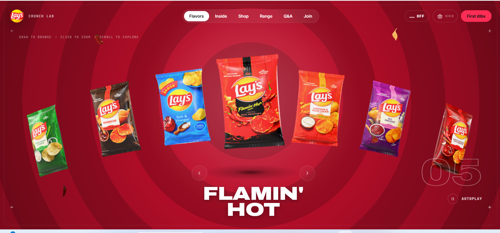
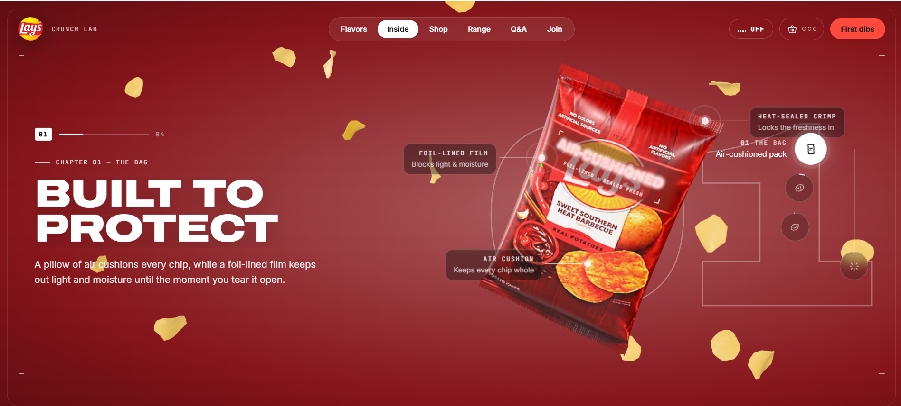
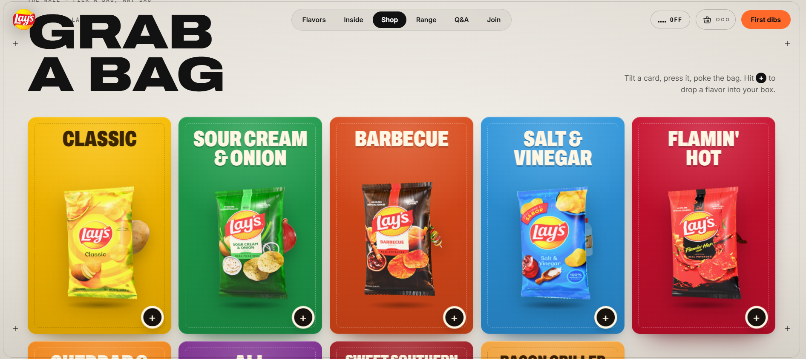
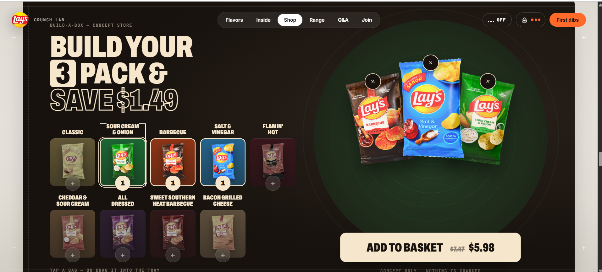
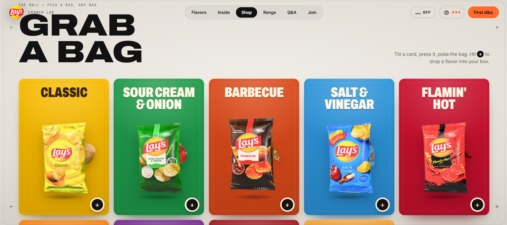
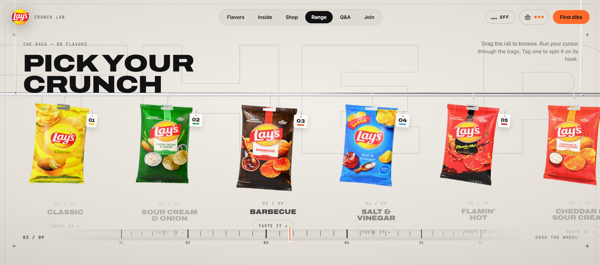

# Lay's Crunch Experience 🥔✨

A scroll-driven, 3D flavor showcase for Lay's chips: a cinematic preloader, a hero carousel of real 3D bags, a story section, a flavor wall with a Build-a-Box shop, and "The Rack". It runs in the browser on Three.js, GSAP and Lenis.

## Screenshots













## Tech Stack

- **Vite**: Modern development server and production bundler
- **Three.js**: 3D WebGL renderer, procedural pillow-bag geometry, crimped heat-seals, realistic foil shader, floating 3D saddle chips, and spice particle physics
- **GSAP + ScrollTrigger**: Smooth timeline scrubbing, chapter transitions, and kinetic typography
- **Lenis**: Buttery smooth inertial scrolling synchronized with GSAP
- **Web Audio API**: Synthetic multi-fracture potato chip bite crunches, tactile clicks, swooshes, and ambient sound
- **Python (Pillow)**: Asset prep pipeline (`tools/prep_packs.py`) generating flat 1024x1536 pack artwork, normal maps, specular maps, and clean cutouts for all 9 flavors

## Architecture & Features

1. **Cinematic Preloader (`src/preloader.js`)**:
   - Spinning 3D hero chip seasoned with falling spice dust
   - Dynamic percentage counter with progress status
   - Interactive crunch burst reveal transitioning smoothly into the hero view

2. **Hero 3D Carousel (`src/scene.js`, `src/bag.js`)**:
   - 3D pillow bags arranged along a parabolic circular arc
   - Seamless wrap navigation via arrows, keyboard, drag, and autoplay
   - Concentric radial flavor rings blending smoothly between active flavor palettes

3. **Inside Story (`src/story.js`)**:
   - Pinned 4-chapter narrative: *The Bag*, *The Crunch*, *The Seasoning*, *The Potato*
   - Interactive hotspot pins with leader lines calling out heat-sealed crimps, foil barriers, and air cushions
   - Atmospheric chip storm triggering upon chapter completion

4. **Flavor Wall & Build-A-Box Concept Store (`src/shop.js`)**:
   - Flavor Wall with 3D card tilt and ingredient reveal
   - Build-A-Box 3-pack picker with dynamic radar tray, bag removal, quantity indicators, and bundle discount calculation ($7.47 → $5.98)
   - Slide-out basket drawer with live subtotal and simulated checkout

5. **The Rack (`src/rack.js`)**:
   - Overhead metallic snack rail with hanging clips and price tags
   - Tactile pendulum swinging physics when brushing past bags, and 360° spin on tap
   - Calibrated graduation dial / scrubber wheel for browsing the lineup

6. **Audio Manager (`src/audio.js`)**:
   - Realistic multi-stage procedural crunch synthesizer
   - Header sound toggle (`... OFF` / `♫ ON`)

## Getting Started

1. **Install dependencies**:
   ```bash
   npm install
   ```

2. **Run development server**:
   ```bash
   npm run dev
   ```

3. **Build for production**:
   ```bash
   npm run build
   ```

4. **Preview production build**:
   ```bash
   npm run preview
   ```
